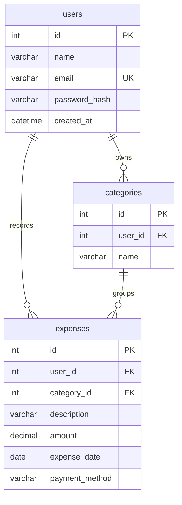

# Database guide

Paisa uses **MySQL 8.0.16 or newer** with three tables: `users`, `categories`, and `expenses`. SQLAlchemy maps Python classes to these tables; PyMySQL connects to MySQL. The app does not use JSON storage. SQLite is used only by automated tests.

## Setup

1. Install and start MySQL Server.
2. From the project root, activate the Python environment and install `requirements.txt`.
3. Run `python database/setup.py`. Enter your MySQL root password, or press Enter if your local installation has none.
4. The script creates the database and application user, generates credentials, verifies the connection and saves settings privately in `.env`. Existing passwords are preserved. The script is for the default local server on port 3306; it stops if `.env` specifies a different host, port, database or user.
5. Run `flask --app app init-db` to create the tables.

`setup.py` preserves the database setup procedure actually used on the original laptop, with a portable project path and a root-password prompt for other laptops. It also handles generating the session secret for a fresh setup. The previous unused SQL setup and schema files have been removed. `tracker/models.py` is the source of the table definitions; `init-db` creates them through SQLAlchemy.

`init-db` creates missing tables but **does not migrate existing tables**. Back up data and use an explicit SQL migration if the models change later. Your current laptop is already configured; just start Flask for normal use.

## Relationships



A user can have many categories and expenses. Each expense belongs to exactly one user and category. A composite foreign key from `expenses(category_id, user_id)` to `categories(id, user_id)` ensures an expense cannot reference someone else's category, even if data is inserted directly through SQL.

## Table: `users`

| Column | MySQL type | Rules | Meaning |
| --- | --- | --- | --- |
| `id` | INT | Primary key, auto increment, not null | Internal user identifier |
| `name` | VARCHAR(80) | Not null | Name displayed in the interface |
| `email` | VARCHAR(254) | Unique, not null | Sign-in email, trimmed and lowercased by the app |
| `password_hash` | VARCHAR(255) | Not null | Werkzeug salted password hash; never the original password |
| `created_at` | DATETIME | Not null | Account creation time in UTC, supplied by Python |

## Table: `categories`

| Column | MySQL type | Rules | Meaning |
| --- | --- | --- | --- |
| `id` | INT | Primary key, auto increment, not null | Category identifier |
| `user_id` | INT | Foreign key → users.id, not null | Owner of this category |
| `name` | VARCHAR(40) | Not null | Display name such as Groceries or Transport |

The pair `(user_id, name)` is unique: two users can both have “Groceries”, but one user cannot create it twice. With the database's `utf8mb4_unicode_ci` collation, uniqueness is case insensitive. The additional unique pair `(id, user_id)` supports the expense ownership foreign key. Registration creates eight starter categories for each new account.

## Table: `expenses`

| Column | MySQL type | Rules | Meaning |
| --- | --- | --- | --- |
| `id` | INT | Primary key, auto increment, not null | Expense identifier |
| `user_id` | INT | Foreign key → users.id, not null | Owner of the expense |
| `category_id` | INT | Part of composite foreign key, not null | Selected category owned by the same user |
| `description` | VARCHAR(160) | Not null | Short description, e.g. Weekly groceries |
| `amount` | DECIMAL(12,2) | Not null, CHECK > 0 | Rupees and paise; up to 10 digits before decimal |
| `expense_date` | DATE | Not null | Date of spending, without time of day |
| `payment_method` | VARCHAR(20) | Not null, CHECK against allowed values | UPI, Cash, Debit card, Credit card, Bank transfer |

All columns are required. The Python model supplies `UPI` by default when omitted programmatically; the form always supplies it. `created_at` and the payment default are application defaults, not SQL server defaults. Direct SQL inserts must supply these values.

The `(user_id, expense_date)` index supports user-specific date filtering. Primary keys, unique constraints and foreign keys also have supporting indexes in MySQL. Foreign keys restrict deleting referenced users/categories; there is no cascading deletion or account/category deletion screen.

## Why this structure?

- Separate users, categories and expenses avoid copying names and login information into each expense.
- `DECIMAL`, together with Python `Decimal`, avoids floating-point rounding errors for money.
- Currency is always INR, so a repeated currency column is unnecessary.
- Totals, averages and charts are calculated from expenses rather than stored as duplicate summary data.
- Every application expense query is scoped to the signed-in user. Form tokens protect writes against cross-site request forgery.
- Empty text, invalid dates, dates in the future, invalid categories and fractional paise are rejected by the application. These application rules are additional to the database constraints.

## Example read queries

Replace user ID `1` and the date range with your own values.

```sql
-- Monthly total, including an explicit zero when no rows match.
SELECT COALESCE(SUM(amount), 0) AS total_inr
FROM expenses
WHERE user_id = 1
  AND expense_date >= '2026-09-01'
  AND expense_date < '2026-10-01';

-- User's category totals across all time.
SELECT c.name, COUNT(e.id) AS expense_count,
       COALESCE(SUM(e.amount), 0) AS total_inr
FROM categories AS c
LEFT JOIN expenses AS e ON e.category_id = c.id AND e.user_id = c.user_id
WHERE c.user_id = 1
GROUP BY c.id, c.name
ORDER BY total_inr DESC;
```

## Maintenance and troubleshooting

- **Connection refused:** ensure MySQL is running and `DB_HOST` / `DB_PORT` match.
- **Access denied:** check the username, password and local host grant. Do not use the MySQL administrator account as the app account.
- **Unknown database:** run `python database/setup.py` first.
- **Table doesn't exist:** run `flask --app app init-db`.
- Back up using MySQL Workbench's export feature or `mysqldump` before changing the schema.
- Do not commit `.env`, database dumps containing personal information, or real passwords.
